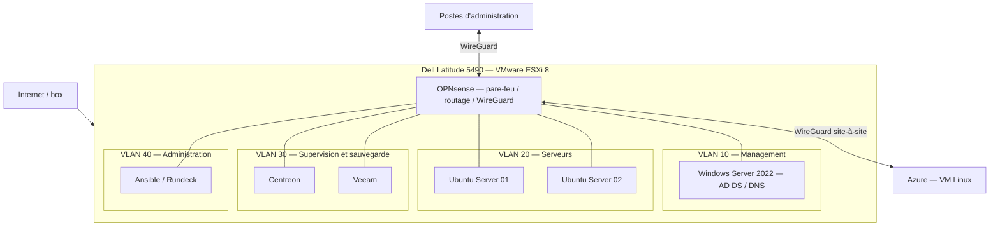

# Infrastructure hybride automatisée

**[Français](#présentation) · [English](#english-version)**

Projet personnel d'infrastructure systèmes et réseaux, déployé sur un **Dell Latitude 5490 dédié avec VMware ESXi 8**.

## Présentation

J'ai construit un environnement associant Windows Server, Linux et Microsoft Azure pour administrer des services, automatiser certaines configurations, superviser leur fonctionnement et tester la restauration de systèmes.

L'infrastructure repose sur un hôte ESXi installé directement sur le matériel. Le réseau interne est réparti en quatre VLAN, avec OPNsense pour le routage, le filtrage et les connexions VPN WireGuard.

## Architecture

*Schéma logique simplifié. Les réseaux et informations d'accès détaillés restent dans la documentation privée.*

## Composants et réalisations

| Domaine | Mise en œuvre |
| --- | --- |
| Virtualisation | VMware ESXi 8 en bare-metal, machines virtuelles Windows et Linux, réseau virtuel isolé |
| Réseau et sécurité | OPNsense, quatre VLAN, filtrage interzones, VPN WireGuard |
| Identité | Active Directory et DNS sur Windows Server 2022 ; intégration Linux avec `realmd` et `SSSD` |
| Automatisation | Playbooks Ansible, script PowerShell pour l'annuaire et orchestration Rundeck |
| Supervision | Centreon, NRPE / NSClient++ et SNMP |
| Sauvegarde | Veeam, sauvegardes planifiées et points de restauration |
| Cloud hybride | VM Linux Azure reliée au lab par un tunnel WireGuard |

## Test de reprise du contrôleur de domaine

J'ai simulé l'indisponibilité du contrôleur de domaine puis restauré sa sauvegarde sur une nouvelle machine virtuelle avec Veeam. Après le redémarrage, j'ai vérifié les services Active Directory et DNS, puis l'authentification d'un compte du domaine sur un serveur Linux et ses droits `sudo`.

Un nouveau test chronométré est prévu pour distinguer le temps de restauration, les vérifications de services et la durée totale d'indisponibilité. Aucun objectif de temps de reprise (RTO) n'est annoncé à ce stade.

La procédure détaillée sera publiée dans `runbooks/reprise-controleur-domaine.md` après anonymisation.

## Organisation du dépôt

- `docs/` : architecture, virtualisation, réseau, identité, automatisation, supervision, sauvegarde et Azure ;
- `diagrams/` : schémas d'architecture ;
- `ansible/` : playbooks et exemples d'inventaire expurgés ;
- `powershell/` : scripts d'administration ;
- `rundeck/` : définitions de jobs exportables ;
- `runbooks/` : procédures de maintenance et de reprise ;
- `evidence/` : captures de tests anonymisées.

Les dossiers seront alimentés progressivement avec les configurations et documents vérifiés. Les informations sensibles, clés, identifiants et adresses publiques ne sont pas publiés.

---

## English version

### Overview

I built a personal hybrid infrastructure lab on a dedicated **Dell Latitude 5490 running VMware ESXi 8 on bare metal**. It combines Windows Server, Linux and Microsoft Azure, with a focus on system administration, configuration automation, monitoring, backups and recovery testing.

The internal network is divided into **four VLANs**. OPNsense provides routing, firewall filtering and WireGuard VPN connectivity. A Linux VM in Azure is connected to the lab through a WireGuard tunnel.

### Technical scope

| Area | Implementation |
| --- | --- |
| Virtualization | VMware ESXi 8, Windows and Linux virtual machines |
| Networking | OPNsense, four VLANs, inter-zone firewall rules, WireGuard |
| Identity | Windows Server 2022 Active Directory and DNS; Linux integration through `realmd` and `SSSD` |
| Automation | Ansible playbooks, PowerShell and Rundeck |
| Monitoring | Centreon, NRPE / NSClient++ and SNMP |
| Backup | Veeam scheduled backups and restore points |
| Hybrid cloud | Azure Linux VM connected through WireGuard |

### Domain controller recovery test

I simulated a domain controller outage and restored its backup to a new virtual machine using Veeam. I then checked Active Directory and DNS services and confirmed that a domain account could authenticate on a Linux server with working `sudo` permissions.

A new timed recovery test is planned to distinguish the technical restoration time, service validation time and overall outage duration. No recovery time objective (RTO) is claimed at this stage.

### Repository contents

The repository is organized around technical documentation (`docs/`), diagrams (`diagrams/`), automation (`ansible/`, `powershell/`, `rundeck/`), operating procedures (`runbooks/`) and anonymized test evidence (`evidence/`). Detailed technical documentation is written in French.

This is a **personal lab**, not a production environment. Configurations and examples are reviewed to avoid publishing credentials or sensitive access details.
