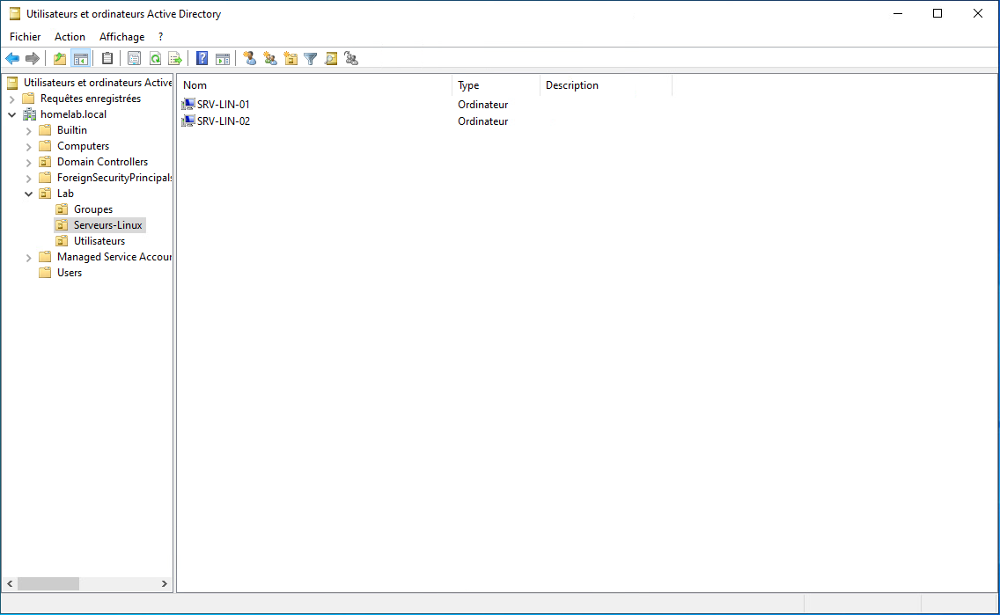
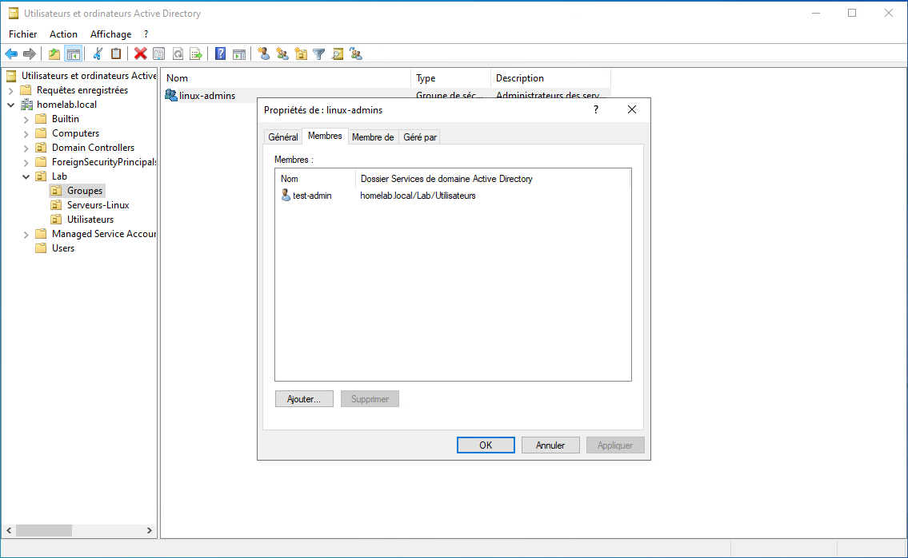
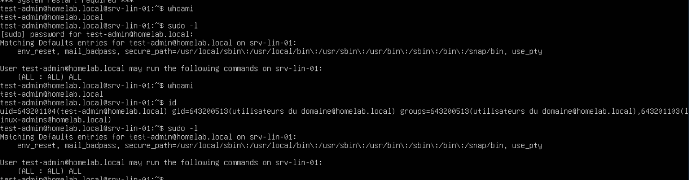

# Active Directory et intégration Linux

## 1. Environnement

J'ai installé Active Directory Domain Services (AD DS) et DNS sur Windows Server 2022, avec le domaine `homelab.local`. J'ai ensuite joint deux serveurs Ubuntu Server 24.04 à l'annuaire afin d'utiliser des comptes AD pour les connexions SSH et de déléguer les droits `sudo` à un groupe.

### Pourquoi intégrer Linux à Active Directory ?

J'ai choisi d'utiliser une même source d'identités pour les machines Windows et Linux du lab. Cela m'a permis de tester la résolution des comptes AD avec SSSD, le contrôle de l'accès SSH par groupe et la délégation de `sudo`, plutôt que de gérer séparément les comptes d'administration de chaque serveur. La désactivation d'un compte AD a également été testée sur les nouvelles connexions SSH. Des comptes locaux de secours restent indépendants de l'annuaire.

| Machine | Rôle |
| --- | --- |
| `HOMELAB` | Contrôleur de domaine et DNS ; exécution du script PowerShell |
| `srv-lin-01` | Première jonction, réalisée manuellement |
| `srv-lin-02` | Seconde jonction, réalisée avec Ansible |
| `ctrl-ansible` | Exécution des playbooks et tests SSH |

## 2. Préparation de l'annuaire avec PowerShell

**Exécution : `HOMELAB`, dans PowerShell avec les droits d'administration du domaine.**

J'ai écrit [`Initialize-LabAD.ps1`](../powershell/Initialize-LabAD.ps1) pour créer la structure d'OU et les identités nécessaires aux tests d'intégration Linux.

```text
OU=Lab
├── OU=Serveurs-Linux
├── OU=Utilisateurs
└── OU=Groupes
```

Le script interroge l'annuaire avant toute création. Il utilise `Get-ADDomain` pour obtenir le Distinguished Name du domaine et une fonction `Ensure-OU` pour éviter de recréer les unités existantes. Celles-ci sont protégées contre la suppression accidentelle.

Il crée ensuite le groupe de sécurité global `linux-admins`, ainsi que `test-admin` et `test-user`. Seul `test-admin` est ajouté au groupe `linux-admins`, qui servira à définir les droits Linux.

Les mots de passe sont demandés à l'exécution, sans être enregistrés dans le script :

```powershell
$pw = Read-Host "Mot de passe pour $u" -AsSecureString
```

Les captures de la section 8 montrent cette organisation et l'appartenance de `test-admin` au groupe.

## 3. Jonction manuelle de `srv-lin-01`

**Exécution : terminal de `srv-lin-01`.**

J'ai commencé avec `realmd` et `SSSD` pour vérifier manuellement la découverte du domaine, la jonction, les connexions et l'attribution des droits.

### Incident : domaine non détecté

La commande suivante échouait :

```bash
realm discover homelab.local
```

```text
No such realm found: homelab.local
```

Une interrogation directe des enregistrements DNS sur le contrôleur de domaine fonctionnait pourtant. En comparant `realm -v`, `resolvectl query` et les requêtes DNS directes, j'ai identifié une différence entre le serveur DNS et le résolveur local `systemd-resolved`.

Le domaine `.local` était traité selon les règles du mDNS et n'était pas dirigé vers le DNS AD en l'absence d'un domaine de recherche attaché à l'interface. J'ai vérifié cette hypothèse avec une modification temporaire :

```bash
sudo resolvectl domain ens34 homelab.local
realm discover homelab.local
```

La découverte a alors fonctionné. J'ai rendu le réglage permanent dans Netplan, sous l'interface `ens34`, avec le domaine de recherche :

```yaml
nameservers:
  search:
    - homelab.local
```

Il s'agit d'un **extrait**, pas du fichier Netplan complet. J'ai appliqué la configuration avec `sudo netplan try`, puis contrôlé la découverte du domaine après redémarrage.

### Jonction et vérification côté AD

**Exécution : `srv-lin-01`.**

```bash
sudo realm join \
  --computer-ou="OU=Serveurs-Linux,OU=Lab,DC=homelab,DC=local" \
  -U Administrateur homelab.local
realm list
```

L'option `--computer-ou` place le compte machine dans l'unité prévue au lieu du conteneur par défaut.

**Vérification : `HOMELAB`, dans PowerShell.**

```powershell
Get-ADComputer -Identity "SRV-LIN-01"
```

La présence de `SRV-LIN-01` dans l'OU `Serveurs-Linux` a été confirmée.

## 4. Connexions SSH et délégation sudo

**Configuration : `srv-lin-01`.**

La politique de connexion initiale autorisait les comptes du domaine. J'ai limité les accès au groupe `linux-admins` :

```bash
sudo realm deny --all
sudo realm permit -g linux-admins@homelab.local
realm list
```

Le fichier `/etc/sudoers.d/linux-admins` contient :

```text
%linux-admins@homelab.local ALL=(ALL:ALL) ALL
```

Sa syntaxe a été contrôlée avec `visudo`. Cette règle autorise les membres du groupe à utiliser `sudo`, **avec demande de mot de passe**.

**Tests SSH : depuis `ctrl-ansible` vers `srv-lin-01`.**

| Compte | Connexion | `sudo` |
| --- | --- | --- |
| `test-admin` | Autorisée | Autorisé après saisie du mot de passe |
| `test-user` | Autorisée temporairement pour le test | Refusé |

Sur la session de `test-admin`, `whoami` confirme l'identité AD, `id` indique notamment le groupe `linux-admins` et `sudo -l` affiche `(ALL : ALL) ALL`. Les journaux `/var/log/auth.log` permettent également de retrouver l'identité AD utilisée.

## 5. Test de désactivation d'un compte

**Désactivation : `HOMELAB`, PowerShell.**

```powershell
Disable-ADAccount -Identity "test-admin"
Get-ADUser -Identity "test-admin" -Properties Enabled
```

**Vérification : connexion SSH depuis `ctrl-ansible` vers `srv-lin-01`.**

Les tentatives de nouvelle connexion avec le même compte et le bon mot de passe ont été refusées. Après `Enable-ADAccount -Identity "test-admin"` exécuté sur `HOMELAB`, la connexion a de nouveau réussi.

Ce test vérifie l'interdiction des **nouvelles sessions** dans les conditions observées ; il ne démontre pas la fermeture automatique des sessions déjà ouvertes.

## 6. Intégration de `srv-lin-02` avec Ansible

**Exécution : `ctrl-ansible`. Machine cible : `srv-lin-02`.**

Après la première jonction manuelle, j'ai créé [`iam-linux.yml`](../ansible/iam-linux.yml) pour reproduire les mêmes paramètres sur le second serveur.

Le playbook vérifie le domaine DNS associé à `ens34`, installe les paquets nécessaires, détecte si la machine est déjà jointe, effectue la jonction si nécessaire, configure `mkhomedir`, limite les connexions au groupe AD et dépose la règle `sudo` en validant sa syntaxe avec `visudo`.

Le contrôle préalable utilise l'état réel du résolveur :

```yaml
- name: Lire le domaine DNS rattaché à l'interface
  command: "resolvectl domain {{ ad_interface }}"
  register: dns_domain
  changed_when: false

- name: Vérifier que le résolveur sait atteindre l'annuaire
  assert:
    that:
      - ad_domain in dns_domain.stdout
```

Le mot de passe de jonction est demandé à l'exécution :

```yaml
vars_prompt:
  - name: ad_join_password
    prompt: "Mot de passe du compte de jonction"
    private: yes
```

### Incident : conflit de configuration Netplan

La première version du playbook tentait de modifier Netplan. La jonction a échoué car le domaine de recherche n'était pas effectivement appliqué à l'interface. Le diagnostic a révélé plusieurs définitions réseau pour la même interface, avec des noms différents.

J'ai corrigé la configuration de `srv-lin-02` puis séparé la préparation réseau du playbook IAM : ce dernier **vérifie** le prérequis DNS au lieu de modifier une configuration Netplan non maîtrisée.

Après correction, le playbook a permis de joindre `srv-lin-02` au domaine. Les tests ont confirmé la connexion et les droits `sudo` de `test-admin`, ainsi que le refus de connexion de `test-user` sur ce serveur.

## 7. Limites

Le lab ne possède qu'un seul contrôleur de domaine. Les authentifications nécessitant l'AD dépendent de sa disponibilité ; le comportement hors ligne dépend notamment du cache SSSD et de son état.

Les comptes de service locaux et un compte administrateur local de secours restent indépendants de l'annuaire.

Le suffixe `homelab.local` a nécessité un domaine de recherche explicite sur les interfaces Ubuntu. Ce n'est pas une recommandation générale d'utiliser `.local` pour un nouveau domaine : il s'agit de la configuration réellement déployée et du correctif appliqué.

Les sauvegardes et la restauration du contrôleur de domaine seront détaillées séparément.

## 8. Captures d'écran

Les captures montrent l'état de la configuration au moment de leur réalisation. Cliquez sur une miniature pour ouvrir l'image complète.

| Organisation des OU | Groupe `linux-admins` |
| :---: | :---: |
| [](../images/active-directory/organisation-ou.png) | [](../images/active-directory/groupe-linux-admins.png) |

| Authentification AD et droits sudo sur Linux |
| :---: |
| [](../images/active-directory/integration-linux-sudo.png) |
