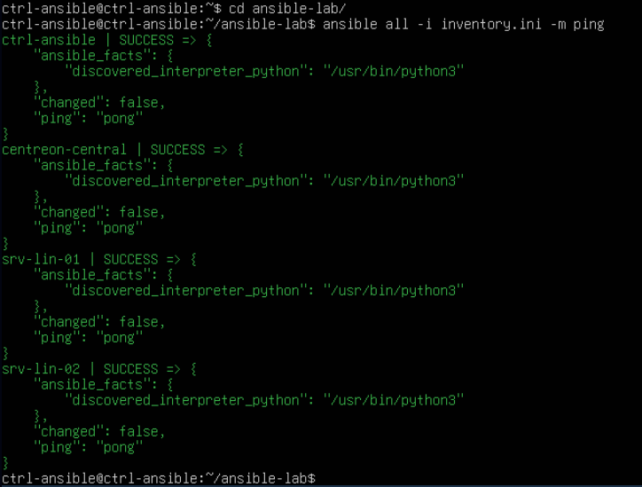
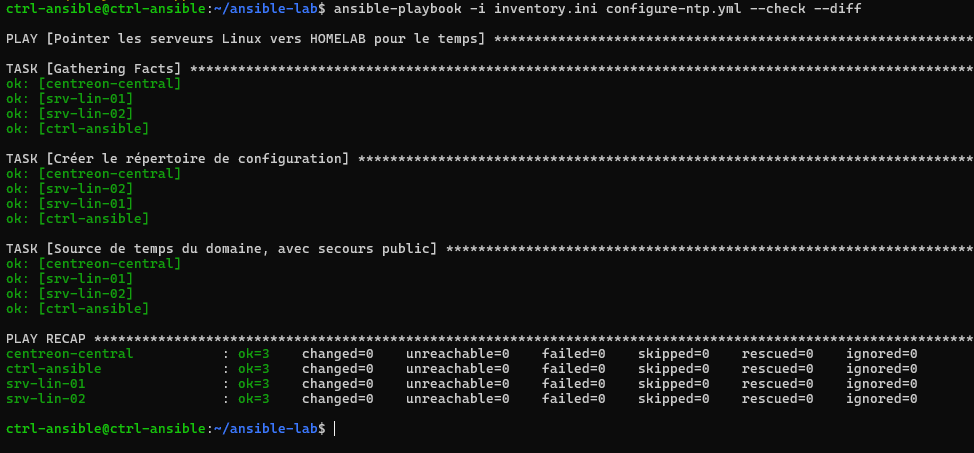
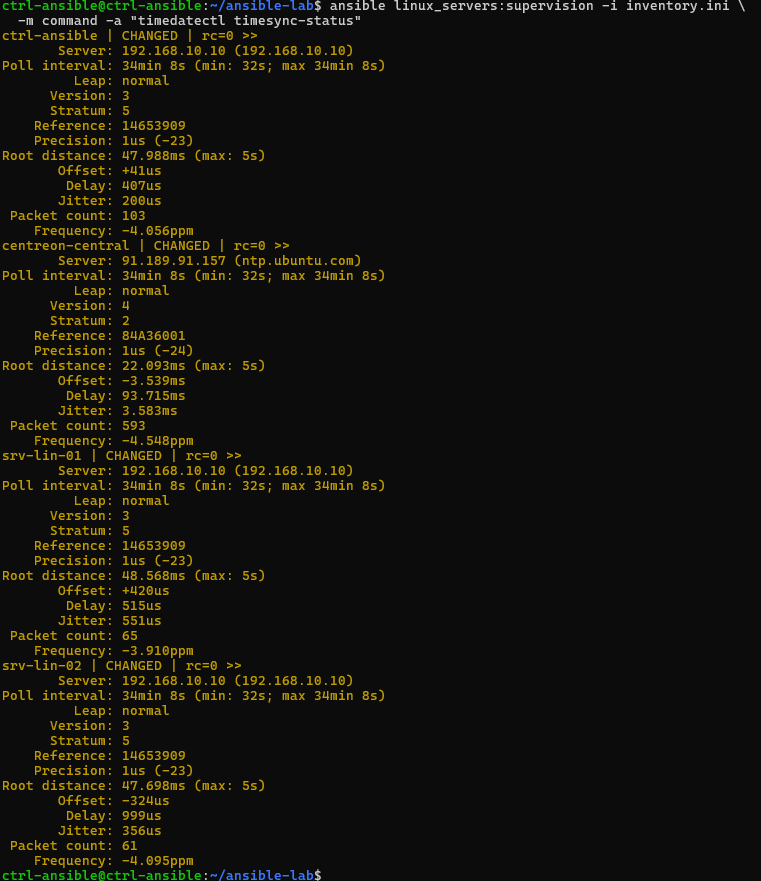

# Automatisation — Ansible

## 1. Rôle dans le lab

Ansible est installé sur `ctrl-ansible`, dans le VLAN 40. Il est utilisé pour configurer les serveurs Linux du lab, notamment leur intégration à Active Directory. Les communications vers le VLAN 20 passent par OPNsense.

## 2. Intégration Linux à Active Directory

Le playbook [`iam-linux.yml`](../ansible/iam-linux.yml) automatise la jonction de `srv-lin-02` au domaine `homelab.local` et configure les accès des comptes AD. `srv-lin-01` a d'abord été intégré manuellement pour valider les étapes.

| Élément | Configuration |
| --- | --- |
| Serveur d'exécution | `ctrl-ansible` |
| Machine cible | `srv-lin-02` |
| Domaine | `homelab.local` |
| Outils | `realmd`, `SSSD`, `adcli` |
| Groupe autorisé | `linux-admins@homelab.local` |
| Délégation `sudo` | `/etc/sudoers.d/linux-admins` |

### Déroulement du playbook

1. Vérification du domaine de recherche DNS associé à `ens34` avec `resolvectl`.
2. Installation des paquets d'intégration AD.
3. Contrôle de la jonction existante avec `realm list`.
4. Jonction au domaine lorsque la machine n'en est pas membre.
5. Activation de la création automatique du répertoire personnel.
6. Restriction des connexions AD au groupe `linux-admins`.
7. Installation de la règle `sudo`, validée avec `visudo`.
8. Contrôle final de l'appartenance au domaine et des autorisations.

Le mot de passe de jonction est demandé à l'exécution. La tâche de jonction utilise `no_log: true`.

## 3. Incident DNS et Netplan

La première version du playbook tentait de modifier Netplan. Sur `srv-lin-02`, plusieurs définitions réseau concernaient la même interface et le domaine de recherche DNS n'était pas correctement appliqué. La jonction AD a échoué.

La configuration réseau a été corrigée sur la VM. Le playbook IAM vérifie maintenant le domaine DNS de l'interface et s'arrête si ce prérequis n'est pas respecté. Il ne modifie plus Netplan.

## 4. Vérifications

Après correction du réseau, `srv-lin-02` a rejoint le domaine. Les tests ont confirmé la connexion de `test-admin` et ses droits `sudo`, ainsi que le refus d'accès de `test-user` sur cette machine.

Les commandes et les vérifications des comptes sont détaillées dans [Active Directory et intégration Linux](active-directory.md).

## 5. Connectivité des machines

Depuis `ctrl-ansible`, la commande suivante a été exécutée avec l’inventaire local :

```bash
ansible all -i inventory.ini -m ping
```

Les quatre hôtes `ctrl-ansible`, `centreon-central`, `srv-lin-01` et `srv-lin-02` ont répondu `SUCCESS`. Ce module vérifie que la connexion Ansible et l’exécution Python fonctionnent sur les machines cibles ; il ne s’agit pas d’un ping ICMP.

## 6. Gestion de la synchronisation horaire

Le playbook `configure-ntp.yml`, présent sur `ctrl-ansible`, gère un fichier de configuration `systemd-timesyncd` sur les groupes `linux_servers` et `supervision` :

| Paramètre | Valeur |
| --- | --- |
| Hôtes ciblés | `ctrl-ansible`, `centreon-central`, `srv-lin-01`, `srv-lin-02` |
| Service | `systemd-timesyncd` |
| Source NTP interne | `192.168.10.10` (`HOMELAB`) |
| Autre source configurée | `ntp.ubuntu.com` |
| Fichier géré | `/etc/systemd/timesyncd.conf.d/homelab.conf` |
| Application | Handler de redémarrage si le fichier change |

La configuration NTP avait été mise en place manuellement avant ce contrôle. La syntaxe du playbook a été validée avec `--syntax-check`. La commande `--list-hosts` a confirmé les quatre machines ciblées ; leur service `systemd-timesyncd` était actif et leur horloge synchronisée.

Le contrôle `--check --diff`, puis **deux exécutions réelles consécutives** du playbook, ont produit les mêmes compteurs sur chaque machine : `ok=3`, `changed=0`, `failed=0`, `unreachable=0`. Aucun redémarrage du service n’a été déclenché. Ces résultats valident le maintien d’une configuration déjà conforme ; ils ne constituent pas un test de déploiement depuis un état vierge.

Le contrôle `timedatectl timesync-status` a montré que trois machines utilisaient `192.168.10.10` comme source NTP active. `centreon-central` utilisait `ntp.ubuntu.com`, également présent dans sa configuration.

## 7. Captures d’écran

| Connectivité Ansible : quatre machines | Validation du playbook NTP |
| :---: | :---: |
| [](../images/ansible/connectivite-machines.png) | [](../images/ansible/controle-ntp-check-mode.png) |

[](../images/ansible/sources-ntp.png)

## 8. Périmètre

Le playbook `iam-linux.yml` publié cible `srv-lin-02`. Il configure l'intégration AD et les droits associés. La supervision et l'orchestration des opérations sont assurées séparément par Centreon et Rundeck.

Voir [Orchestration — Rundeck](rundeck.md).
