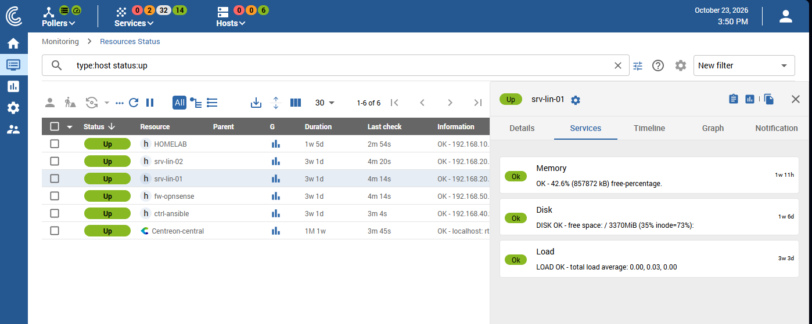
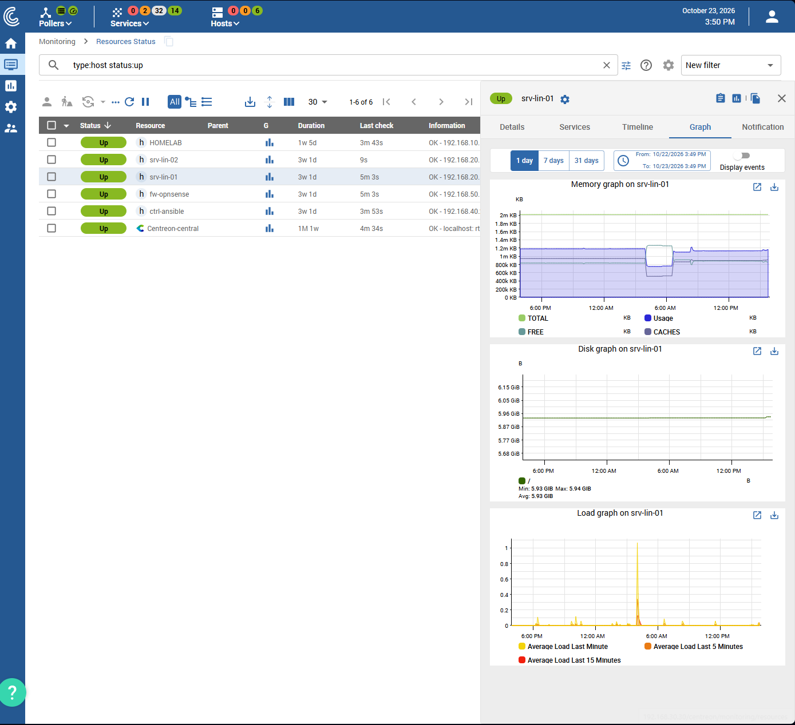

# Supervision — Centreon

## 1. Rôle dans le lab

Centreon est installé dans le VLAN 30, avec les composants de sauvegarde. Il supervise les systèmes Windows et Linux du lab ainsi que des équipements réseau.

Les contrôles utilisent NRPE, NSClient++ ou SNMP selon les machines et les équipements.

## 2. Architecture de supervision

| Élément | Rôle |
| --- | --- |
| Centreon | Centralisation des états de supervision |
| Serveurs Linux | Cibles de contrôles système et services |
| Systèmes Windows | Cibles des contrôles Windows |
| Équipements réseau | Cibles des contrôles réseau |
| NRPE / NSClient++ / SNMP | Collecte des informations selon les cibles |
| OPNsense | Routage et filtrage entre les VLAN |

La supervision communique avec les machines des autres VLAN selon les règles du pare-feu OPNsense.

## 3. Fonctionnement des contrôles

Centreon distingue la disponibilité des hôtes et l'état des services surveillés. Un serveur peut être joignable alors qu'un de ses services est indisponible.

Les contrôles et leurs résultats sont consultés depuis l'interface Centreon. Les états des services facilitent le repérage d'un défaut de fonctionnement sur une machine supervisée.

## 4. Hôtes et services supervisés

La vue de statut Centreon affiche six hôtes en état `UP` : `HOMELAB`, `srv-lin-01`, `srv-lin-02`, `fw-opnsense`, `ctrl-ansible` et `Centreon-central`.

Sur `srv-lin-01`, les services `Memory`, `Disk` et `Load` sont tous en état `OK`. Les informations affichées comprennent la mémoire, l’espace disque disponible et les moyennes de charge du système.

## 5. Historique des métriques

L’onglet graphique de `srv-lin-01` affiche des mesures sur 24 heures pour la mémoire, le disque et la charge système. Les courbes rendent visibles l’évolution de la mémoire, la stabilité de l’espace disque et un pic ponctuel de charge.

## 6. Captures d’écran

| État des hôtes et services | Graphiques système |
| :---: | :---: |
|  |  |

## 7. Limites de l’architecture

Centreon est hébergé sur l'unique hôte ESXi du lab. Si cet hôte devient indisponible, la plateforme locale de supervision s'arrête également.

Voir [Architecture générale](architecture.md) et [Réseau et sécurité — OPNsense](reseau-securite.md).
