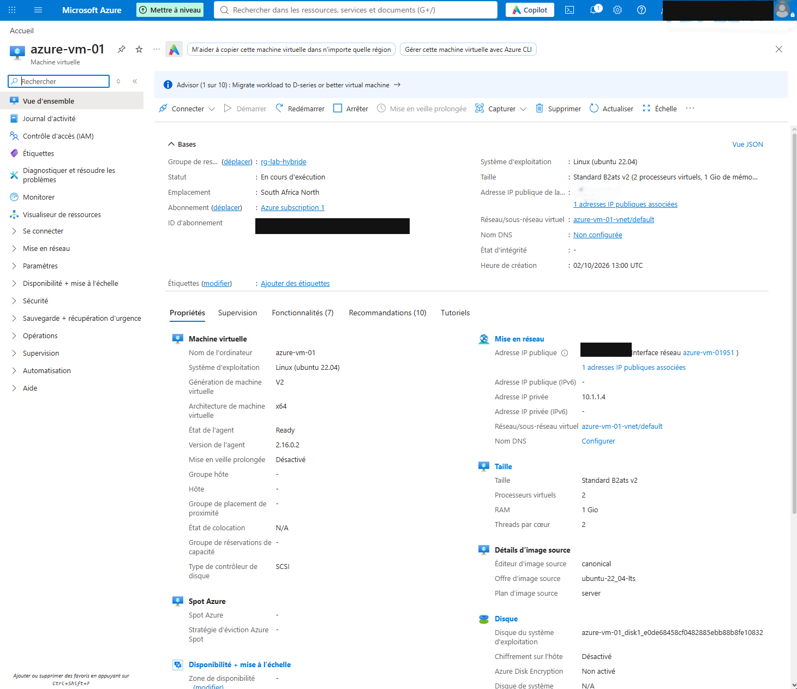
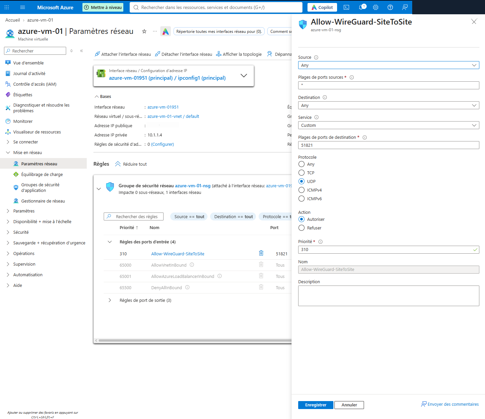
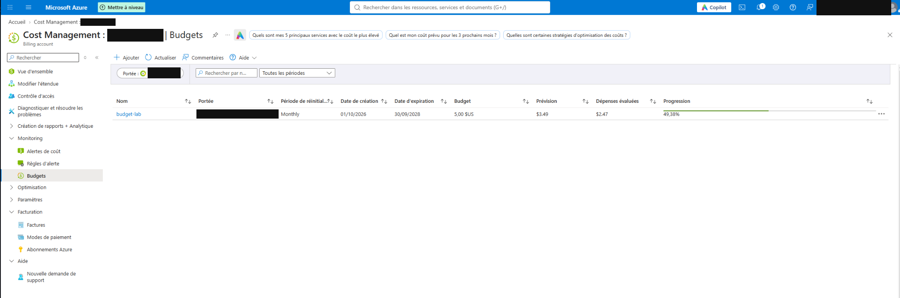

# Microsoft Azure — Déploiement et sécurisation

## 1. Objectif

Une machine virtuelle Ubuntu a été déployée sur Microsoft Azure pour étendre le homelab ESXi à un environnement cloud. Les principaux travaux portent sur le déploiement, les quotas, le réseau, le filtrage des accès, la connexion VPN et le suivi des coûts.

La configuration détaillée du tunnel est présentée dans [VPN WireGuard — Administration distante et liaison Azure](vpn-wireguard.md). La topologie locale et les VLAN sont décrits dans [Architecture de l'infrastructure hybride](architecture.md).

## 2. Ressources Azure

| Ressource | Configuration |
| --- | --- |
| Groupe de ressources | `rg-lab-hybride` |
| VM | `azure-vm-01` |
| Système | Ubuntu Server 22.04 LTS |
| Région | South Africa North |
| Taille | `Standard_B2ats_v2` — 2 vCPU, 1 Gio de RAM |
| Réseau virtuel | `azure-vm-01-vnet` |
| Sous-réseau | `default` |
| Réseau privé | `10.1.1.0/24` |
| IP privée de la VM | `10.1.1.4` |
| IP publique | Statique, utilisée comme endpoint WireGuard |
| Adresse WireGuard | `10.20.20.1/24` |

L'adresse IP publique a été ajoutée après le déploiement : le parcours de création utilisé ne l'avait pas provisionnée automatiquement. L'affectation statique permet à OPNsense d'utiliser un endpoint stable pour établir le VPN.



## 3. Incident de déploiement : quotas Azure

La création initiale de la VM a été bloquée par un quota **B-series à zéro** dans plusieurs régions testées : France Central, West Europe, North Europe, UK South et East US.

La taille `Standard_B2ats_v2` a finalement pu être déployée dans la région **South Africa North**. La VM Ubuntu 22.04 a été créée, puis l'adresse IP publique ajoutée.

Le changement de région a résolu le blocage de provisionnement. La région étant éloignée du lab, la latence reste un point à prendre en compte ; les mesures sont présentées dans les tests de connectivité.

Ce problème relevait du quota disponible sur l'abonnement utilisé, pas d'une erreur de configuration Linux ou réseau.

## 4. Réseau et accès

La VM possède une interface dans le réseau privé Azure `10.1.1.0/24`, avec l'adresse `10.1.1.4`. Une adresse IP publique statique permet à OPNsense de joindre le port WireGuard de la VM.

Le trafic d'administration ne passe pas directement par SSH sur cette adresse publique : il traverse le tunnel WireGuard.

```text
Homelab — VLAN 40 / ctrl-ansible
           |
       OPNsense
           |
    Internet / UDP 51821
           |
      VM Azure
      WireGuard wg0 : 10.20.20.1
      IP privée Azure : 10.1.1.4
```

Le lab est actuellement raccordé directement à la Freebox. Une connexion temporaire via le PC de travail a été utilisée pendant un incident décrit plus bas ; elle ne correspond pas à la topologie actuelle.

## 5. Sécurité réseau : NSG

Un **Network Security Group (NSG)** est associé à l'interface réseau de la VM.

Les règles entrantes retenues sont les suivantes :

| Flux | Configuration |
| --- | --- |
| WireGuard | `Allow-WireGuard-SiteToSite`, UDP `51821`, priorité `310` |
| Source de la règle WireGuard | `Any`, car l'IP publique utilisée par le lab pouvait changer |
| SSH depuis Internet | Règle d'autorisation TCP 22 supprimée |
| Autres flux entrants | Règles Azure par défaut, dont `DenyAllInBound` |

L'ouverture UDP 51821 ne suffit pas à établir un tunnel : WireGuard vérifie que le pair utilise les clés attendues. La règle NSG ne remplace pas les mises à jour et la protection des clés privées.

Après suppression de la règle SSH publique, une connexion directe depuis Internet a échoué avec `Connection timed out`. La connexion SSH depuis `ctrl-ansible`, via `10.20.20.1`, reste fonctionnelle.



## 6. Tunnel WireGuard avec OPNsense

WireGuard a été installé directement sur la VM Ubuntu pour éviter de déployer une passerelle Azure VPN Gateway supplémentaire. Cela permet de réutiliser la VM existante, mais la configuration et la disponibilité du VPN restent à gérer.

| Paramètre | Azure | Homelab |
| --- | --- | --- |
| Équipement | `azure-vm-01` | OPNsense |
| Interface / instance | `wg0` | `wg-azure` |
| IP du tunnel | `10.20.20.1/24` | `10.20.20.2/24` |
| Port d'écoute | UDP `51821` | UDP `51822` |
| Initiative de la connexion | Attend le pair | Initie le tunnel |
| Endpoint fixe du pair | Non renseigné | Adresse publique statique Azure |

Un keepalive de 25 secondes est configuré côté OPNsense. Le pare-feu connaît le réseau Azure `10.1.1.0/24` comme destination du pair distant ; les réseaux du lab sont définis de l'autre côté dans `AllowedIPs`.

Sur OPNsense, l'interface `WG_AZURE` ne comporte pas de règle autorisant librement les connexions initiées depuis Azure vers les VLAN. Un ping lancé depuis Azure vers `ctrl-ansible` a été bloqué ; le journal OPNsense affichait un refus entrant sur `WG_AZURE`.

## 7. Tests de connectivité

Depuis `ctrl-ansible` (VLAN 40), les adresses `10.20.20.1` (interface WireGuard) et `10.1.1.4` (adresse privée Azure) ont été testées.

Le contrôle vers l'interface WireGuard donne :

```console
$ ping -c 4 10.20.20.1
4 packets transmitted, 4 received, 0% packet loss
rtt min/avg/max/mdev = 159.172/159.526/159.768/0.245 ms
```

Une connexion SSH par le tunnel a également réussi :

```console
$ ssh azureadmin@10.20.20.1
$ hostname
azure-vm-01
$ whoami
azureadmin
$ ip -br addr show wg0
wg0 UNKNOWN 10.20.20.1/24
```

Le [test SSH et ping depuis `ctrl-ansible`](../images/wireguard/connectivite-azure.png) montre l’accès privé à la VM Azure.

## 8. Administration de secours

La fermeture du SSH public rend l'administration habituelle dépendante du tunnel VPN. En cas de coupure, Azure Cloud Shell permet de vérifier le service sans réouvrir TCP 22 sur Internet.

La commande suivante a été utilisée pour consulter l'état de WireGuard via les outils d'administration Azure :

```bash
az vm run-command invoke \
  --resource-group rg-lab-hybride \
  --name azure-vm-01 \
  --command-id RunShellScript \
  --scripts 'sudo wg show'
```

Cette méthode dépend de l'accès au plan de gestion Azure et du fonctionnement de l'agent invité de la VM.

## 9. Incident : interruption du VPN Azure

Le tunnel Azure ne répondait plus. Les contrôles effectués via Azure indiquaient que la VM était démarrée, que WireGuard fonctionnait et que la règle NSG UDP `51821` était toujours présente. Le dernier handshake datait de plusieurs heures.

Pendant cette période, le lab **n'était plus relié directement à la Freebox**. Le Dell ESXi était connecté par Ethernet au PC de travail, lui-même connecté à Internet. Le PC devait fournir l'accès Internet à l'hôte au moyen du **partage de connexion Windows (NAT)**.

Ce partage n'était pas activé sur la carte Ethernet reliée au Dell. OPNsense n'avait donc pas de sortie Internet et ne pouvait plus initier le tunnel vers Azure.

Après activation du partage de connexion sur cette carte, la connectivité du lab a été rétablie et le tunnel a pu se reconnecter. **L'hôte ESXi a ensuite été rebranché directement à la Freebox**, qui correspond à l'architecture actuelle.

Le diagnostic rappelle de vérifier la sortie Internet d'OPNsense avant de modifier les clés WireGuard ou les règles NSG.

## 10. Suivi des coûts

Un budget mensuel `budget-lab` de **5 USD** a été configuré dans Azure Cost Management.

Au moment de la capture, Azure affichait :

| Indicateur | Valeur affichée |
| --- | --- |
| Budget mensuel | 5,00 USD |
| Dépenses évaluées | 2,47 USD |
| Prévision | 3,49 USD |
| Progression | 49,38 % |

Le budget déclenche un suivi et des alertes ; il n'arrête pas automatiquement les ressources. L'arrêt de la VM ne supprime pas nécessairement les frais liés aux disques et à l'IP publique statique.



## 11. Limites

Cette mise en place repose sur une seule VM Azure, un seul pare-feu OPNsense et un seul hôte ESXi. Le tunnel dépend aussi de l'accès Internet du lab.

L'infrastructure ne dispose pas de VPN Gateway managée ni de redondance automatique. Les clés privées WireGuard doivent rester protégées et être renouvelées si elles ont été exposées. Les ressources cloud et les coûts sont à contrôler régulièrement.
