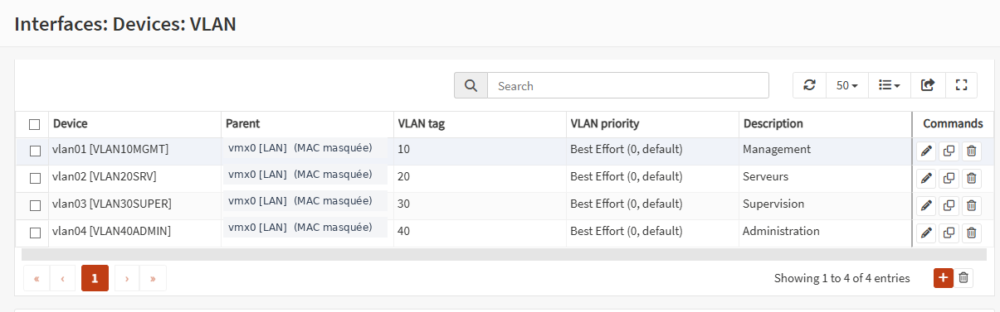
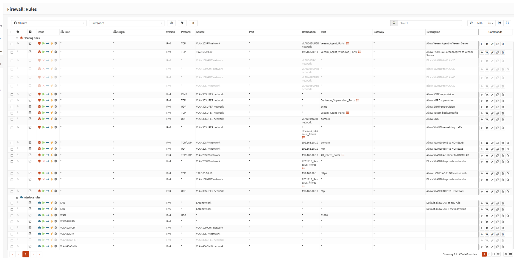

# Réseau et sécurité — OPNsense

## 1. Rôle d'OPNsense

OPNsense assure le routage et le filtrage réseau du lab.

Il assure le routage inter-VLAN, le NAT sortant vers Internet et la terminaison des tunnels WireGuard.

Les réseaux internes sont organisés selon les fonctions des machines : Active Directory, serveurs Linux, supervision, sauvegarde et administration.

Leur répartition et leur configuration dans ESXi sont présentées dans les documents [Architecture](architecture.md) et [Virtualisation](virtualisation.md).

Ce document présente le routage, le filtrage et les incidents rencontrés. Les tunnels sont détaillés dans [VPN WireGuard](vpn-wireguard.md).

### Pourquoi un pare-feu virtuel OPNsense ?

Le réseau interne repose sur un vSwitch ESXi sans liaison physique directe. J'avais besoin d'un équipement assurant le routage entre les zones, le NAT, le filtrage et la terminaison des VPN, sans matériel réseau supplémentaire. J'ai retenu OPNsense pour centraliser ces fonctions dans une machine virtuelle. pfSense aurait également été envisageable ; je n'ai pas réalisé de benchmark entre les deux solutions.

Cette architecture dépend de la disponibilité de l'hôte ESXi et de l'unique VM OPNsense.

## 2. Filtrage inter-VLAN

### Mise en place des règles

Après la création des VLAN, j'ai d'abord utilisé des règles permissives pour valider la connectivité entre les différentes zones.

J'ai ensuite progressivement restreint les communications en conservant les flux nécessaires au fonctionnement des services.

OPNsense utilise un **pare-feu stateful** : il suit l'état des connexions et autorise les paquets de réponse correspondant aux sessions établies.

L'objectif était de limiter les communications initiées entre les VLAN, sans perturber les services comme DNS, la synchronisation horaire ou les sauvegardes.

### Restriction du VLAN 20

J'ai notamment travaillé sur le filtrage du VLAN 20, qui héberge les deux serveurs Linux.

Les règles permettent de conserver :

- les requêtes DNS vers le contrôleur de domaine ;
- la synchronisation horaire ;
- les communications nécessaires aux sauvegardes Veeam ;
- l'accès Internet pour les mises à jour système.

Les autres connexions non autorisées vers les réseaux privés sont bloquées.

Pour éviter de créer une règle distincte pour chaque réseau de destination, j'ai utilisé un alias OPNsense regroupant les réseaux privés concernés.

### Vérification du filtrage

Depuis `srv-lin-01`, j'ai vérifié que :

- l'accès SSH au contrôleur de domaine était bloqué ;
- l'accès SSH au serveur Ansible/Rundeck était bloqué ;
- l'interface web d'ESXi n'était plus accessible ;
- la résolution DNS et l'accès Internet fonctionnaient toujours ;
- les communications nécessaires à Veeam restaient autorisées.

Ces tests ont permis de vérifier à la fois les restrictions appliquées et le maintien des services nécessaires.

## 3. Incident : règle de pare-feu appliquée trop largement

Pendant le durcissement du VLAN 20, une règle destinée à bloquer les communications vers les réseaux privés a provoqué une perte de connectivité sur plusieurs services.

### Symptômes

La règle ne concernait pas uniquement les serveurs Linux. Elle bloquait également de nouvelles connexions provenant d'autres réseaux.

Les effets observés comprenaient notamment :

- une interruption de nouvelles connexions WireGuard ;
- une perte d'accès à certaines interfaces d'administration ;
- le blocage de flux qui ne provenaient pas du VLAN 20.

Le problème est apparu progressivement, car les connexions déjà établies continuaient temporairement de fonctionner grâce à la table d'états du pare-feu.

### Diagnostic

J'ai commencé par vérifier que les paquets arrivaient sur l'interface WAN d'OPNsense.

J'ai ensuite utilisé `tcpdump` pour examiner les événements de filtrage et identifier la règle responsable.

```bash
tcpdump -ni vmx1
tcpdump -nei pflog0 udp port 51820
```

L'inspection des règles réellement chargées avec la commande suivante a permis d'identifier le problème :

```bash
pfctl -vvsr
```

La règle de blocage ne comportait ni l'interface ni la source attendues.

Elle s'appliquait donc à un périmètre beaucoup plus large que celui initialement prévu.

### Rétablissement des accès

Pour rétablir temporairement la connectivité, j'ai vidé en mémoire la table d'adresses associée à la règle concernée.

Cette intervention était temporaire : elle ne supprimait pas la règle de la configuration persistante, et un rechargement du pare-feu pouvait rétablir le blocage.

J'ai ensuite supprimé puis recréé les règles concernées.

### Second problème : ordre d'évaluation des règles

Après cette correction, les nouvelles règles ciblaient correctement le VLAN 20, mais les tests montraient que certaines connexions restaient autorisées.

En examinant les compteurs et l'ordre des règles avec `pfctl`, j'ai constaté que les règles de blocage n'étaient pas évaluées avant une règle générale d'autorisation déjà présente.

J'ai corrigé leur placement en utilisant des **règles flottantes (*floating rules*)**, avec une source explicitement définie.

Les règles nécessaires aux services autorisés sont placées avant le blocage général des autres destinations privées.

### Validation

Après correction, j'ai effectué de nouveaux tests depuis le VLAN 20 et vérifié le retour des accès d'administration concernés.

Les connexions interdites étaient bloquées, tandis que les communications nécessaires au fonctionnement des services restaient accessibles.

Cet incident m'a conduit à vérifier systématiquement la portée, l'ordre d'évaluation et les compteurs des règles réellement chargées dans le pare-feu, plutôt que de me fier uniquement à leur affichage dans l'interface web.

## 4. Connexions VPN

OPNsense termine deux instances WireGuard distinctes : `wg-lab` pour les postes d'administration (`pc-perso` et `pc-2`), et `wg-azure` pour la liaison site-à-site avec une VM Ubuntu sur Microsoft Azure.

Chaque tunnel dispose de son propre adressage. Les règles OPNsense continuent de filtrer les communications vers les VLAN, même lorsque le tunnel VPN est établi.

La configuration, les `Allowed IPs`, les tests et les incidents sont présentés dans [VPN WireGuard — Administration distante et liaison Azure](vpn-wireguard.md). Le déploiement de la VM et les règles NSG sont détaillés dans [Microsoft Azure — Déploiement et sécurisation](cloud-azure.md).

## 5. Vérifications et outils de diagnostic

Les outils suivants ont été utilisés pour les tests et les diagnostics réseau.

| Outil / commande | Utilisation |
| --- | --- |
| `ping` | Vérification de la connectivité IP |
| `ip route` | Contrôle des routes sur les serveurs Linux |
| `tcpdump` | Capture et analyse du trafic réseau |
| `pfctl -vvsr` | Inspection des règles réellement chargées par le pare-feu |
| `wg show` | Vérification des peers, des handshakes et des Allowed IPs |
| Journaux OPNsense | Identification des connexions autorisées ou bloquées |

Les tests portent autant sur les communications autorisées que sur celles qui doivent être bloquées.

## 6. Captures d'écran

Ces captures présentent la configuration du lab au moment de leur réalisation. Cliquez sur une miniature pour ouvrir l'image complète.

| Interfaces VLAN | Règles de filtrage |
| :---: | :---: |
| [](../images/opnsense/interfaces-vlan.png) | [](../images/opnsense/regles-pare-feu.png) |


## 7. Limites et évolutions prévues

### Limites actuelles

Le routage inter-VLAN et les VPN reposent sur une seule instance OPNsense hébergée sur l'hôte ESXi du lab.

Une indisponibilité de cet hôte ou du pare-feu entraîne donc une interruption des communications qui en dépendent.

### Mise en place d'un serveur bastion

Actuellement, les postes d'administration accèdent aux ressources internes à travers WireGuard, selon les règles de filtrage configurées dans OPNsense.

Une prochaine évolution consistera à déployer un **serveur bastion dans le VLAN 40**, dédié à l'administration.

L'objectif sera de centraliser les connexions vers les serveurs Windows et Linux, de réduire les accès directs depuis les postes distants et d'améliorer la traçabilité des sessions d'administration.

WireGuard restera le moyen d'accès distant au lab. Le bastion constituera un point de passage supplémentaire vers les machines internes.

Cette évolution est prévue, mais n'est pas encore déployée.
