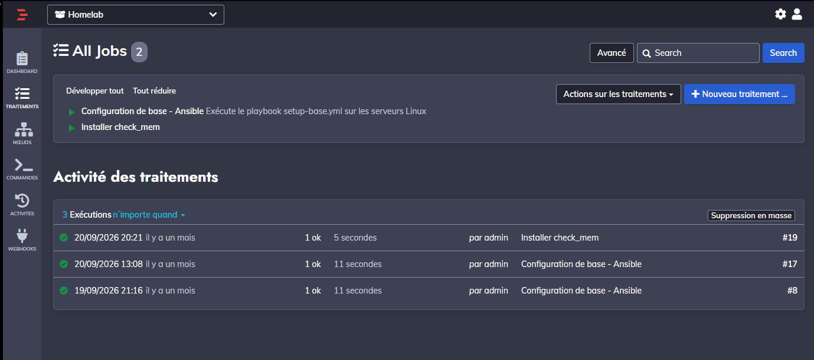
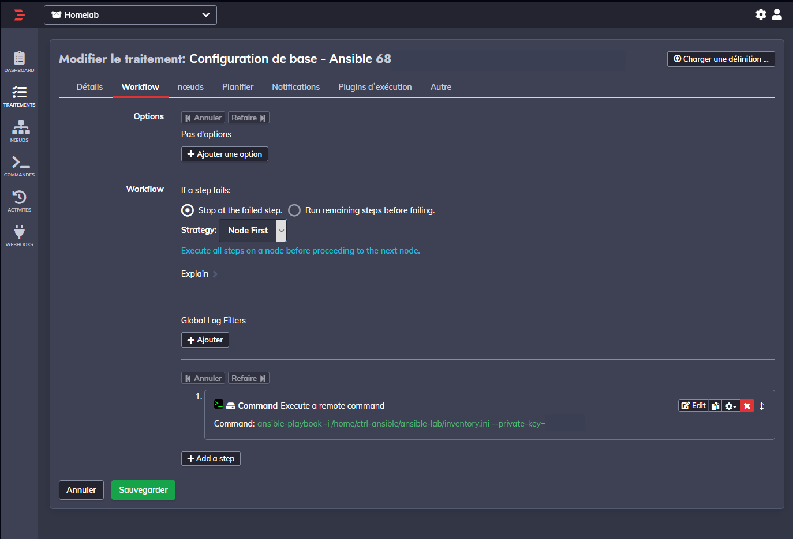
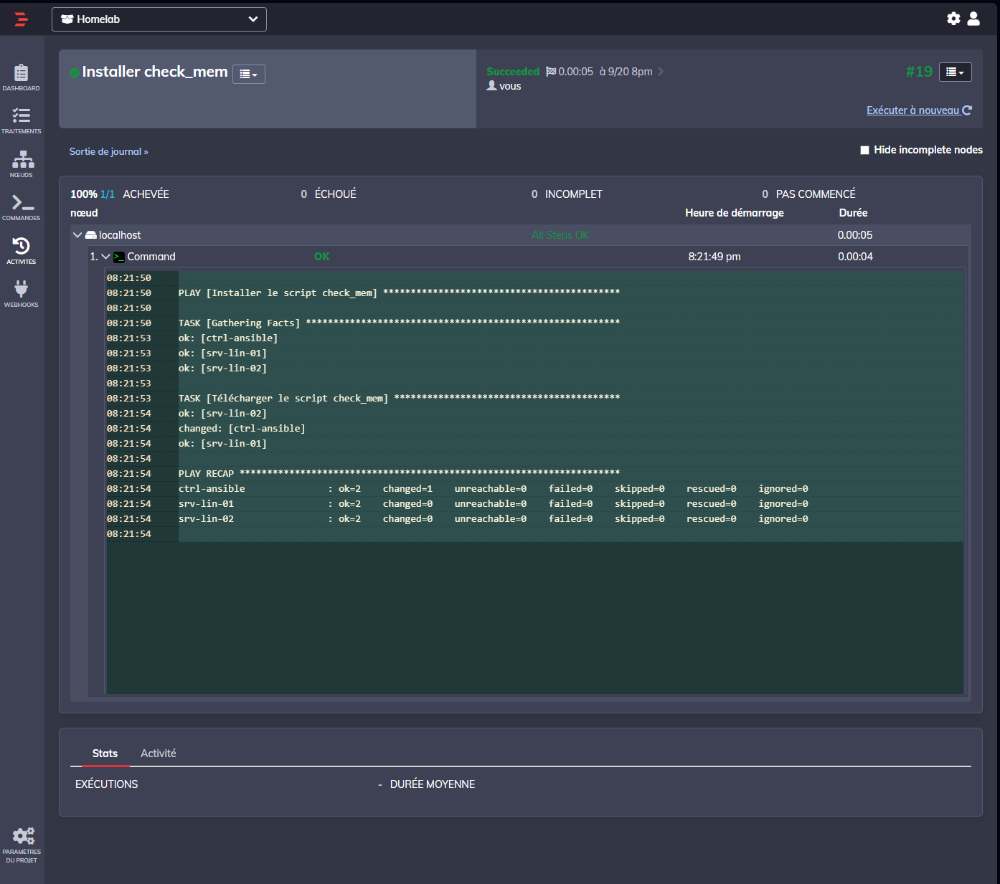

# Orchestration — Rundeck

## 1. Rôle dans le lab

Rundeck est déployé avec Ansible sur `ctrl-ansible`, dans le VLAN 40. Il fournit une interface pour organiser et déclencher des opérations d'administration.

Ansible exécute les tâches de configuration sur les machines cibles ; Rundeck permet d'organiser ces opérations sous forme de jobs.

## 2. Architecture

| Élément | Fonction |
| --- | --- |
| `ctrl-ansible` | Serveur d'administration du VLAN 40 |
| Rundeck | Organisation et lancement des opérations |
| Ansible | Configuration des machines Linux |
| OPNsense | Filtrage entre le VLAN 40 et les réseaux cibles |

Le serveur d'administration communique avec les machines Linux selon les règles définies dans OPNsense. Les connexions SSH et les droits sur les machines cibles restent soumis à leur configuration locale et aux règles Active Directory.

## 3. Jobs configurés

Le projet Rundeck `Homelab` contient deux jobs :

| Job | Rôle |
| --- | --- |
| `Configuration de base - Ansible` | Lance le playbook `setup-base.yml` sur les serveurs Linux |
| `Installer check_mem` | Exécute le playbook d’installation du contrôle mémoire `check_mem` |

Le job de configuration de base utilise une étape de commande lançant `ansible-playbook` avec l’inventaire de `ctrl-ansible` et une clé SSH. Le workflow est configuré avec la stratégie `Node First` et l’arrêt à l’étape en échec.

## 4. Exécution observée

L’historique du projet affiche deux exécutions réussies de `Configuration de base - Ansible` et une exécution réussie de `Installer check_mem`.

Pour l’exécution `#19` du job `Installer check_mem`, Rundeck indique `Succeeded` en cinq secondes. Le journal Ansible contient une tâche de téléchargement du script `check_mem`, avec le résultat suivant :

| Machine | OK | Changed | Failed | Unreachable |
| --- | ---: | ---: | ---: | ---: |
| `ctrl-ansible` | 2 | 1 | 0 | 0 |
| `srv-lin-01` | 2 | 0 | 0 | 0 |
| `srv-lin-02` | 2 | 0 | 0 | 0 |

Le journal démontre l’exécution du playbook depuis Rundeck sur ces trois machines. Il ne mesure pas à lui seul le fonctionnement du contrôle dans Centreon.

## 5. Captures d’écran

| Jobs et historique | Workflow Ansible |
| :---: | :---: |
|  |  |

## 6. Limites de l'architecture

Rundeck et Ansible partagent le même serveur `ctrl-ansible`. Une indisponibilité de cette VM empêche le lancement des opérations depuis ces outils.

Voir [Architecture générale](architecture.md).
