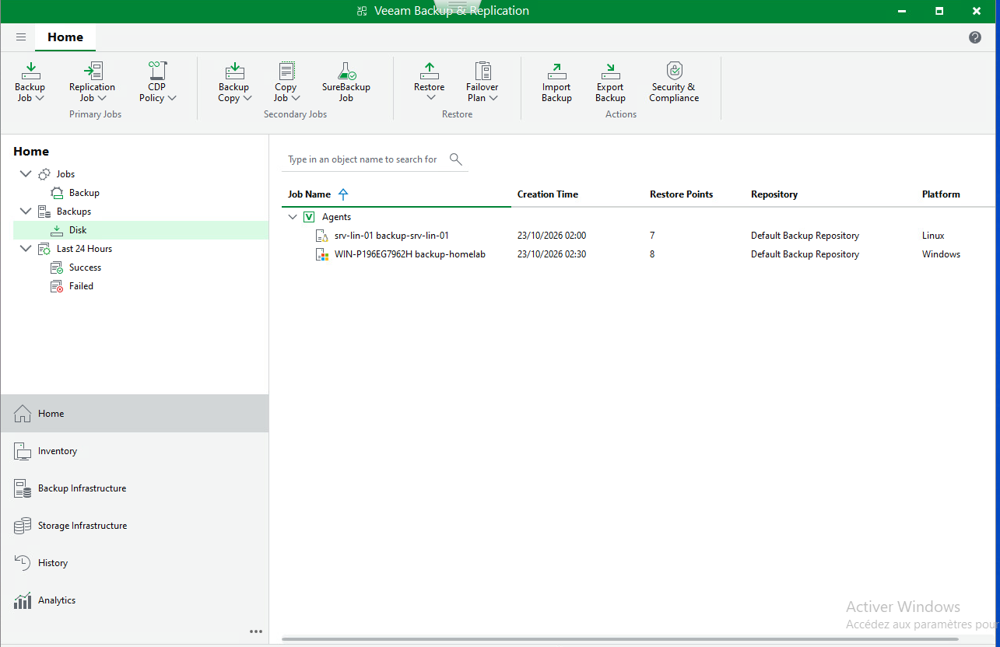
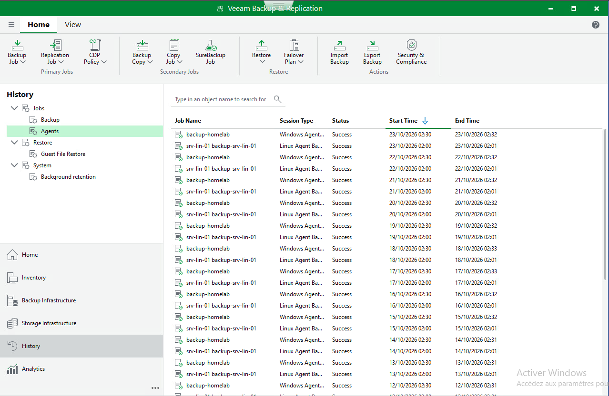
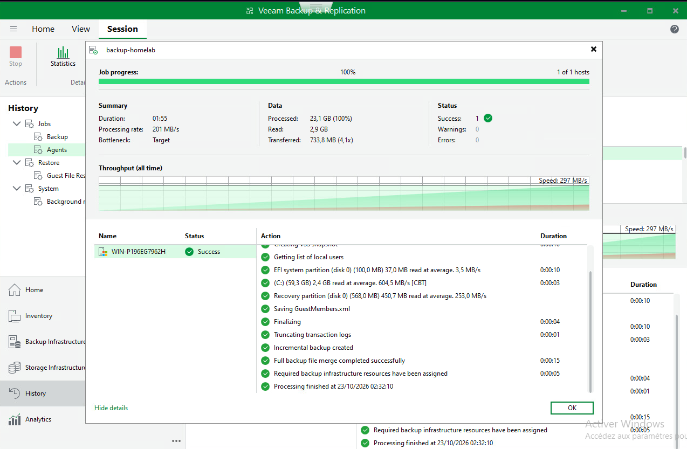
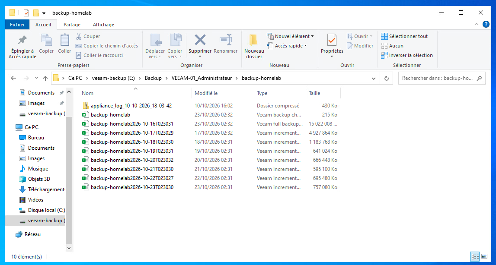
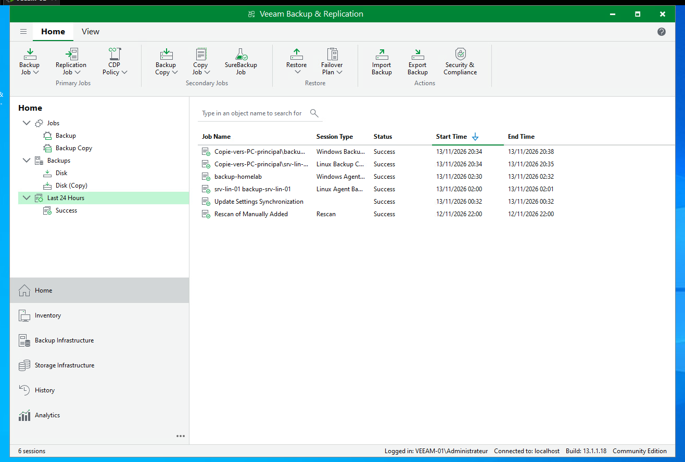
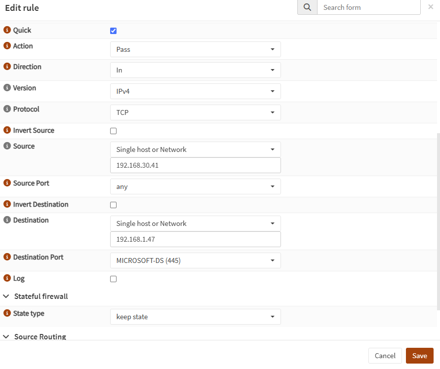

# Sauvegardes — Veeam Backup & Replication

## 1. Infrastructure

Veeam Backup & Replication est installé sur `veeam-01`, dans le VLAN 30. Les agents installés sur les machines protégées transmettent les sauvegardes au serveur Veeam.

| Élément | Configuration |
| --- | --- |
| Serveur de sauvegarde | `veeam-01` — Veeam Backup & Replication 13 Community Edition |
| Dépôt | `Default Backup Repository` |
| Emplacement | Volume `E:`, répertoire `E:\Backup` |
| Stockage | Disque virtuel hébergé sur `datastore-extension`, sur le second SSD de l'hôte ESXi |
| Machines protégées dans ce périmètre | `srv-lin-01` (Linux), contrôleur de domaine `HOMELAB` (Windows Server 2022) |
| Copie hors de l'hôte | Dépôt `Copie-PC-principal` sur le PC d'administration (voir section 6) |

Le dépôt principal et les machines virtuelles restent sur le même hôte physique. Une copie des sauvegardes est donc envoyée sur une autre machine (section 6).

## 2. Sauvegardes configurées

| Machine | Agent | Planification | Points visibles sur la capture |
| --- | --- | --- | --- |
| `srv-lin-01` | Veeam Agent for Linux | Tous les jours à 02 h 00 | 7 |
| `HOMELAB` | Veeam Agent for Windows | Tous les jours à 02 h 30 | 8 |

Les horaires sont décalés de trente minutes pour éviter deux sauvegardes simultanées sur le serveur Veeam.

Les agents sont utilisés directement sur les machines. `HOMELAB` est sauvegardé par l'agent Windows autonome ; `srv-lin-01` envoie ses sauvegardes avec l'agent Linux.

### Agent Linux : incompatibilité du module de snapshot

L'installation initiale du paquet `veeam` sur Ubuntu Server 24.04 échouait à la compilation du module `veeamsnap` avec DKMS. J'ai utilisé la variante `veeam-nosnap`, qui ne nécessite pas ce module. Les sauvegardes de `srv-lin-01` ont ensuite pu s'exécuter vers le dépôt central.

## 3. Incident : connexion de l'agent Windows au serveur Veeam

Pendant la configuration de la sauvegarde Windows, l'agent renvoyait :

```text
Failed to retrieve certificate for host
```

Le port 10006, utilisé précédemment pour l'agent Linux, avait été repris dans la configuration Windows. Or l'agent Windows se connectait au dépôt sur le port **10005**.

Les journaux de l'agent et du serveur ont permis de comparer la connexion Windows avec celle de Linux, qui fonctionnait. Le port 10006 répondait au test réseau mais ne correspondait pas au service attendu par l'agent Windows.

La correction a consisté à utiliser le port 10005 et une règle OPNsense dédiée aux flux de l'agent Windows. La sauvegarde de `HOMELAB` a ensuite réussi.

## 4. Résultats des sauvegardes

L'historique Veeam présente des exécutions réussies des jobs Windows et Linux. Les captures montrent également les sauvegardes complète et incrémentales stockées sur le volume `E:`.

Pour une exécution de `backup-homelab`, les statistiques visibles sont :

| Mesure | Résultat |
| --- | --- |
| État | `Success` |
| Machines traitées | 1/1 |
| Volume traité | 23,1 Go |
| Données lues | 2,9 Go |
| Données transférées | 733,8 Mo |
| Avertissements / erreurs | 0 / 0 |

Les points de restauration visibles et les sessions réussies confirment que les sauvegardes ont été produites. Le test de restauration du contrôleur de domaine est décrit séparément dans le [runbook PRA](../runbooks/reprise-controleur-domaine.md).

## 5. Captures d'écran

| Points de restauration | Historique des sessions |
| :---: | :---: |
| [](../images/veeam/points-restauration.png) | [](../images/veeam/historique-sauvegardes.png) |

| Détail d'une sauvegarde Windows | Fichiers du dépôt |
| :---: | :---: |
| [](../images/veeam/session-backup-homelab.png) | [](../images/veeam/depot-sauvegardes.png) |

## 6. Copie des sauvegardes hors de l'hôte (règle 3-2-1)

### Objectif

Jusqu'ici, les machines virtuelles et leurs sauvegardes se trouvaient sur le même Dell Latitude 5490. Une panne de l'hôte aurait fait perdre les deux à la fois. Un travail de copie Veeam envoie désormais une seconde copie des sauvegardes vers le PC d'administration, une machine physique distincte.

| Copie | Emplacement | Rôle |
| --- | --- | --- |
| Données de production | VM sur l'hôte ESXi | Machines en service |
| Sauvegarde principale | `E:\Backup` sur `veeam-01` | Restauration rapide |
| Copie | Partage SMB sur le PC d'administration (`D:\VeeamCopy`) | Survie à une panne de l'hôte |

### Partage de destination et compte de service

Sur le PC d'administration, un compte local dédié `svc-veeam` a été créé pour ce seul usage, selon le principe du moindre privilège :

- le partage `VeeamCopy` n'est accessible qu'à ce compte ;
- les droits NTFS du dossier sont limités à `svc-veeam` (modification), `Système` et `Administrateurs` ; l'héritage est désactivé ;
- le mot de passe n'apparaît dans aucun script : il est saisi à l'exécution et stocké dans le gestionnaire d'identifiants de Veeam.

L'accès a d'abord été validé hors de Veeam, depuis `veeam-01`, avec `net use`, pour distinguer un problème de compte d'un problème de configuration Veeam.

### Ouverture du flux sur OPNsense

Le VLAN 30 n'a pas le droit de joindre les réseaux privés. Une règle flottante autorise uniquement le flux nécessaire :

| Champ | Valeur |
| --- | --- |
| Action | `Pass`, *Quick* |
| Source | `veeam-01` (`192.168.30.41`) |
| Destination | PC d'administration (`192.168.1.47`, bail DHCP réservé sur la box) |
| Protocole et port | TCP 445 (SMB) |

Le test depuis `veeam-01` montre l'effet de la règle :

| | Ping | `Test-NetConnection -Port 445` |
| --- | --- | --- |
| Avant la règle | Réussi | `TcpTestSucceeded : False` |
| Après la règle | Réussi | `TcpTestSucceeded : True` |

Le ping passait déjà grâce à la règle ICMP de supervision ; seul le port SMB a été ouvert.

### Travail de copie

| Paramètre | Valeur |
| --- | --- |
| Dépôt cible | `Copie-PC-principal` (`\\192.168.1.47\VeeamCopy`), une tâche simultanée au maximum |
| Mode | *Periodic copy* : copie quotidienne à 20 h, quand le PC est allumé |
| Sources | Sauvegardes de `HOMELAB` et de `srv-lin-01` |
| Rétention | 7 points de restauration |
| Chiffrement | Activé : la sauvegarde du contrôleur de domaine contient la base Active Directory |

Le mode *Immediate copy* a été écarté : les sauvegardes s'exécutent à 2 h, une heure où le PC d'administration est généralement éteint.

La première exécution, le 13 novembre 2026, s'est terminée en `Success` pour les deux machines, en environ quatre minutes.

### Limites

- La copie dépend du PC d'administration : s'il est éteint à 20 h, elle est reportée au lendemain.
- Les deux machines restent dans le même logement : la copie protège d'une panne de l'hôte, pas d'un sinistre sur le site. Une copie vers un stockage objet Azure serait l'étape suivante.
- Le mot de passe de chiffrement est indispensable à toute restauration depuis cette copie ; il est conservé hors du lab.

| Copies réussies dans Veeam | Règle OPNsense SMB |
| :---: | :---: |
| [](../images/veeam/copie-hors-hote-success.png) | [](../images/opnsense/regle-smb-veeam-pc.png) |

## 7. Limites

Le dépôt principal est local à l'hôte ESXi ; la copie vers le PC d'administration couvre une panne de l'hôte, mais pas un sinistre sur le site (les deux machines sont au même endroit). Les sauvegardes quotidiennes ne garantissent pas la conservation des modifications effectuées depuis le dernier point.
