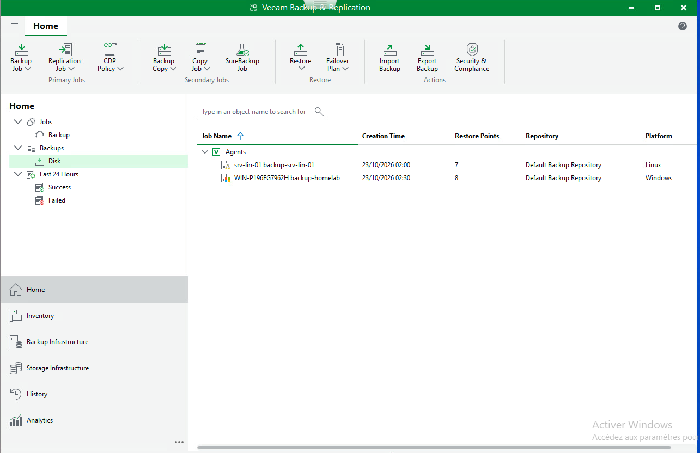
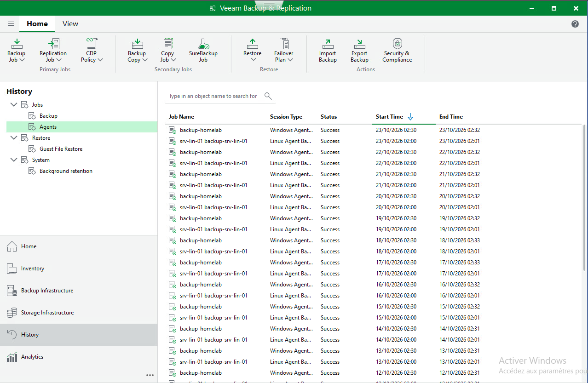
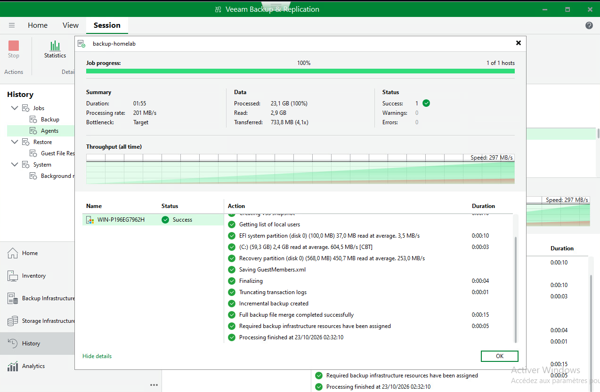
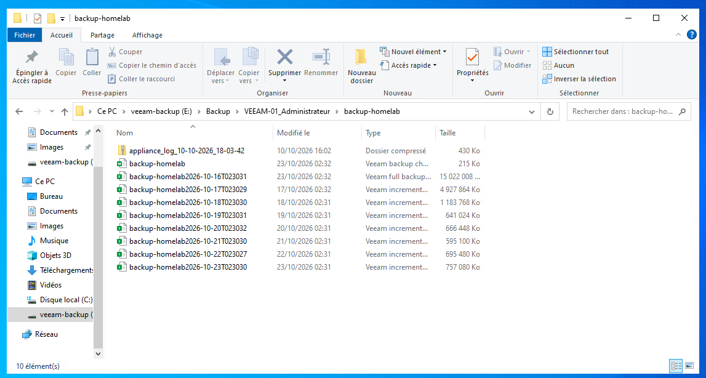

# Sauvegardes — Veeam Backup & Replication

## 1. Infrastructure

Veeam Backup & Replication est installé sur `veeam-01`, dans le VLAN 30. Les agents installés sur les machines protégées transmettent les sauvegardes au serveur Veeam.

| Élément | Configuration |
| --- | --- |
| Serveur de sauvegarde | `veeam-01` — Veeam Backup & Replication 13 Community Edition |
| Dépôt | `Default Backup Repository` |
| Emplacement | Volume `E:`, répertoire `E:\Backup` |
| Stockage | Disque virtuel hébergé sur `datastore-extension`, sur le second SSD de l'hôte ESXi |
| Machines protégées dans ce périmètre | `srv-lin-01` (Linux), contrôleur de domaine `HOMELAB` (Windows Server 2022) |

Le dépôt et les machines virtuelles restent sur le même hôte physique. La séparation des disques ne protège donc pas contre une panne complète du Dell Latitude 5490.

## 2. Sauvegardes configurées

| Machine | Agent | Planification | Points visibles sur la capture |
| --- | --- | --- | --- |
| `srv-lin-01` | Veeam Agent for Linux | Tous les jours à 02 h 00 | 7 |
| `HOMELAB` | Veeam Agent for Windows | Tous les jours à 02 h 30 | 8 |

Les horaires sont décalés de trente minutes pour éviter deux sauvegardes simultanées sur le serveur Veeam.

Les agents sont utilisés directement sur les machines. `HOMELAB` est sauvegardé par l'agent Windows autonome ; `srv-lin-01` envoie ses sauvegardes avec l'agent Linux.

### Agent Linux : incompatibilité du module de snapshot

L'installation initiale du paquet `veeam` sur Ubuntu Server 24.04 échouait à la compilation du module `veeamsnap` avec DKMS. J'ai utilisé la variante `veeam-nosnap`, qui ne nécessite pas ce module. Les sauvegardes de `srv-lin-01` ont ensuite pu s'exécuter vers le dépôt central.

## 3. Incident : connexion de l'agent Windows au serveur Veeam

Pendant la configuration de la sauvegarde Windows, l'agent renvoyait :

```text
Failed to retrieve certificate for host
```

Le port 10006, utilisé précédemment pour l'agent Linux, avait été repris dans la configuration Windows. Or l'agent Windows se connectait au dépôt sur le port **10005**.

Les journaux de l'agent et du serveur ont permis de comparer la connexion Windows avec celle de Linux, qui fonctionnait. Le port 10006 répondait au test réseau mais ne correspondait pas au service attendu par l'agent Windows.

La correction a consisté à utiliser le port 10005 et une règle OPNsense dédiée aux flux de l'agent Windows. La sauvegarde de `HOMELAB` a ensuite réussi.

## 4. Résultats des sauvegardes

L'historique Veeam présente des exécutions réussies des jobs Windows et Linux. Les captures montrent également les sauvegardes complète et incrémentales stockées sur le volume `E:`.

Pour une exécution de `backup-homelab`, les statistiques visibles sont :

| Mesure | Résultat |
| --- | --- |
| État | `Success` |
| Machines traitées | 1/1 |
| Volume traité | 23,1 Go |
| Données lues | 2,9 Go |
| Données transférées | 733,8 Mo |
| Avertissements / erreurs | 0 / 0 |

Les points de restauration visibles et les sessions réussies confirment que les sauvegardes ont été produites. Le test de restauration du contrôleur de domaine est décrit séparément dans le [runbook PRA](../runbooks/reprise-controleur-domaine.md).

## 5. Captures d'écran

| Points de restauration | Historique des sessions |
| :---: | :---: |
| [](../images/veeam/points-restauration.png) | [](../images/veeam/historique-sauvegardes.png) |

| Détail d'une sauvegarde Windows | Fichiers du dépôt |
| :---: | :---: |
| [](../images/veeam/session-backup-homelab.png) | [](../images/veeam/depot-sauvegardes.png) |

## 6. Limites

Le dépôt est local à l'hôte ESXi, sans copie hors site. Une panne du matériel peut donc rendre simultanément indisponibles les VM et leurs sauvegardes. Les sauvegardes quotidiennes ne garantissent pas la conservation des modifications effectuées depuis le dernier point.
