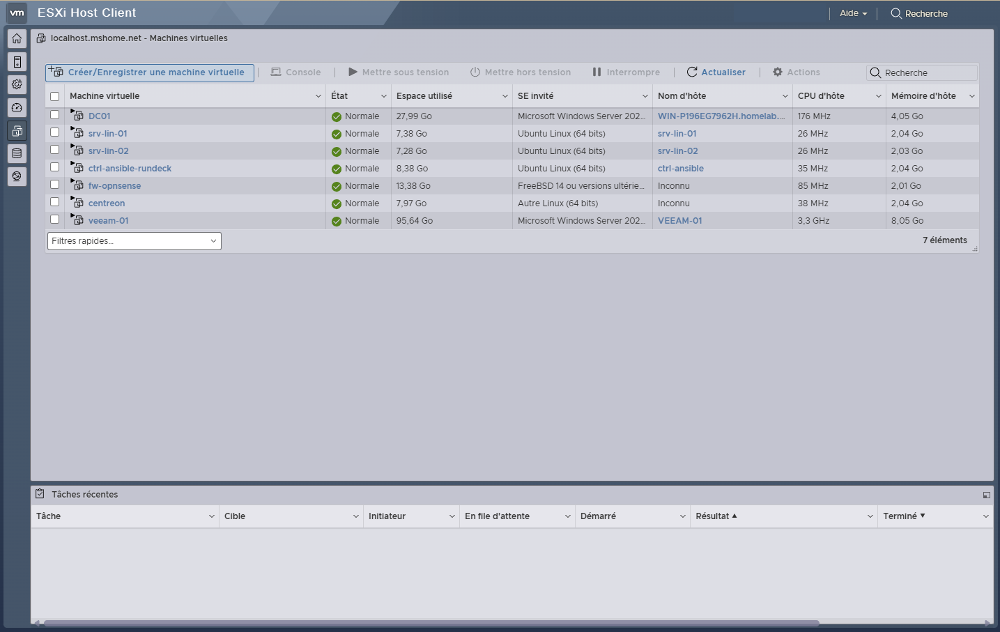
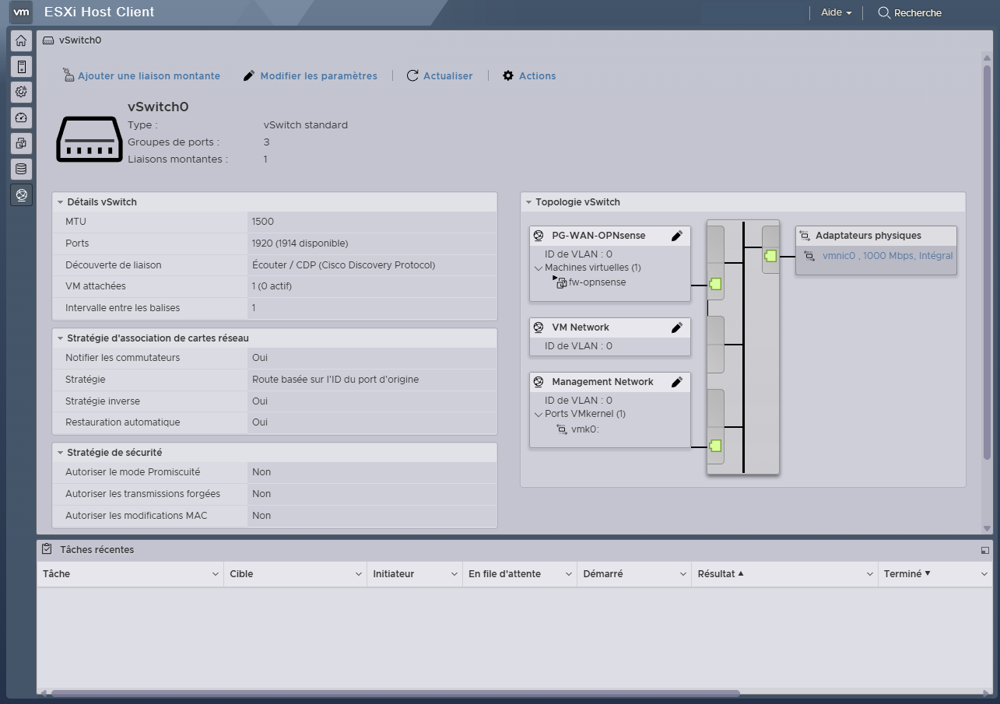
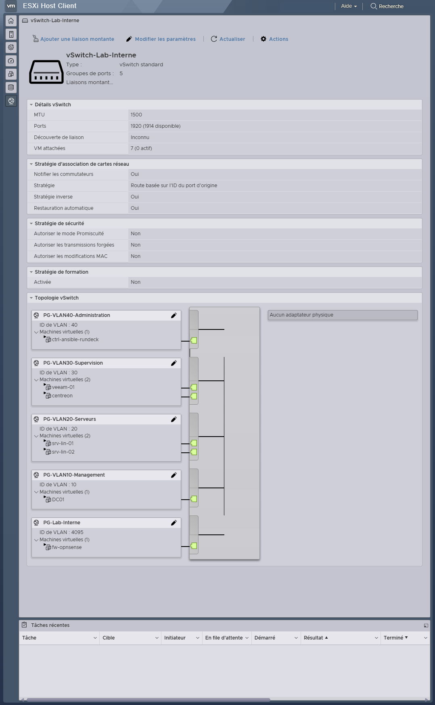
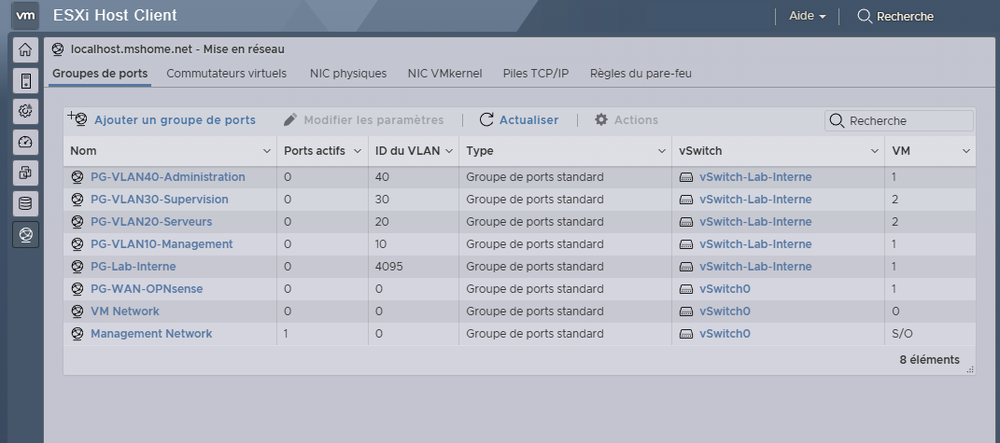

# Virtualisation — VMware ESXi 8

## 1. Installation et organisation

J'ai installé VMware ESXi 8 directement sur un Dell Latitude 5490 dédié à mon infrastructure.

### Pourquoi ESXi en bare-metal ?

ESXi a été installé directement sur le Dell plutôt qu'en virtualisation imbriquée sur le PC principal. Cela permet d'administrer l'hyperviseur et ses commutateurs virtuels tout en conservant le PC pour piloter le lab.

Ce choix implique un point de défaillance unique et des ressources matérielles limitées : il s'agit d'un environnement d'apprentissage, et non d'une plateforme de production.

L'hyperviseur héberge sept machines virtuelles : un contrôleur de domaine Windows Server, deux serveurs Ubuntu, un pare-feu OPNsense, Centreon, Veeam et un serveur d'administration Ansible/Rundeck.

J'ai organisé le réseau virtuel autour de deux commutateurs :

- **`vSwitch0`**, relié à la carte réseau physique, pour la gestion ESXi et le WAN d'OPNsense ;
- **`vSwitch-Lab-Interne`**, sans liaison physique, pour les réseaux internes des machines virtuelles.

Cette organisation permet de conserver un réseau interne isolé du réseau domestique, avec OPNsense comme point de passage vers l'extérieur.

## 2. Adaptation de l'architecture réseau

Au départ, le réseau interne était isolé. Lors de la configuration des serveurs Linux, j'ai constaté que les mises à jour nécessitaient un accès Internet, notamment pour exécuter `apt update`.

J'ai donc déployé OPNsense plus tôt que prévu, avec une interface WAN sur `vSwitch0` et une interface LAN sur `vSwitch-Lab-Interne`.

Cette solution permettait aux machines internes d'accéder à Internet sans les raccorder directement au réseau de gestion ESXi.

Lors du premier paramétrage d'OPNsense, j'ai également dû corriger une inversion d'affectation des interfaces WAN et LAN. Leur identification ne correspondait pas à l'ordre que j'avais supposé lors de leur ajout à la machine virtuelle.

## 3. Mise en place des VLAN

J'ai ensuite créé quatre groupes de ports pour séparer les services :

| VLAN | Fonction |
| --- | --- |
| 10 | Active Directory et DNS |
| 20 | Serveurs Linux |
| 30 | Supervision et sauvegarde |
| 40 | Administration et automatisation |

Chaque machine virtuelle a été déplacée vers son groupe de ports.

J'ai adapté les paramètres IP et DNS depuis les consoles des VM afin de ne pas dépendre d'une connexion SSH pendant les changements réseau.

### Problème de transmission des VLAN vers OPNsense

Pendant la mise en place, le groupe de ports `PG-Lab-Interne`, connecté à OPNsense, était configuré avec le VLAN ID `0`.

Ce réglage empêchait les trames VLAN étiquetées d'arriver correctement jusqu'au pare-feu.

J'ai corrigé la configuration en passant le groupe de ports au VLAN ID `4095`, permettant à OPNsense de recevoir le trafic des différents VLAN.

J'ai ensuite vérifié les communications avec des règles de pare-feu initialement permissives, avant de travailler sur les restrictions entre les zones.

## 4. Extension du stockage

Le stockage initial de l'hyperviseur est devenu insuffisant lors de l'installation de Veeam Backup & Replication.

J'ai ajouté un SSD de 256 Go dans l'emplacement WWAN inutilisé du Dell Latitude 5490, puis créé un second datastore nommé `datastore-extension`.

Ce nouvel espace accueille le serveur Veeam et son dépôt de sauvegarde.

Le stockage des sauvegardes est ainsi séparé du support principal, mais les deux supports restent dans le même équipement physique.

## 5. Vérifications et résultats

Les captures de l'interface ESXi permettent de vérifier :

- la présence des sept machines virtuelles et leur état de fonctionnement au moment de la capture ;
- la liaison physique de `vSwitch0` ;
- l'absence de liaison physique sur `vSwitch-Lab-Interne` ;
- les groupes de ports associés aux VLAN 10, 20, 30 et 40 ;
- la configuration du groupe de ports d'OPNsense avec le VLAN ID `4095`.

Les tests de routage et de filtrage sont détaillés dans [Réseau et sécurité — OPNsense](reseau-securite.md).

## 6. Limites

L'environnement repose sur un seul hôte ESXi, sans haute disponibilité.

Une panne matérielle complète entraîne l'indisponibilité des machines virtuelles locales.

Le dépôt de sauvegarde est placé sur un second support, mais reste dans le même équipement physique.

## Captures d'écran

Ces captures présentent l'état de l'environnement au moment de leur réalisation. Cliquez sur une miniature pour ouvrir l'image complète.

| Machines virtuelles | vSwitch0 |
| :---: | :---: |
|  |  |

| vSwitch-Lab-Interne | Groupes de ports VLAN |
| :---: | :---: |
|  |  |
