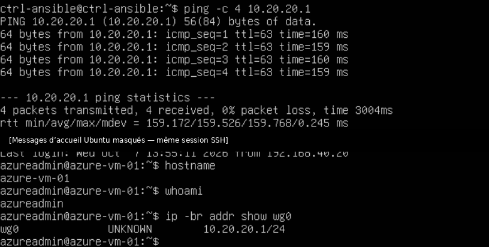

# VPN WireGuard — Administration distante et liaison Azure

## 1. Objectifs

WireGuard est utilisé pour administrer le lab à distance depuis deux postes Windows et pour relier le réseau local à une VM Ubuntu sur Azure. Les deux tunnels se terminent sur OPNsense, qui filtre les communications vers les VLAN.

Le réseau interne, le routage inter-VLAN et les règles générales du pare-feu sont détaillés dans [Réseau et sécurité — OPNsense](reseau-securite.md). Le déploiement de la VM, le NSG et les coûts sont détaillés dans [Microsoft Azure — Déploiement et sécurisation](cloud-azure.md).

## 2. Pourquoi WireGuard ?

WireGuard a été retenu pour sa configuration légère et sa compatibilité avec OPNsense, Windows et Ubuntu. Les autres solutions du tableau n'ont pas fait l'objet de tests comparatifs.

| Solution envisageable | Intérêt pour le projet | Compromis |
| --- | --- | --- |
| **WireGuard — retenu** | Configuration relativement légère, pairs identifiés par clés et support sur OPNsense, Linux et Windows | Gestion des clés, des routes, du filtrage et de la disponibilité à ma charge |
| **IPsec / IKEv2** | Standard pertinent pour les liaisons site-à-site et l'interopérabilité avec des équipements réseau | Davantage de paramètres à gérer pour le périmètre retenu |
| **OpenVPN** | Solution mature et flexible, notamment pour l'accès distant | Composants et configuration supplémentaires par rapport au besoin du lab |
| **Azure VPN Gateway** | Service managé pour relier des réseaux à Azure | Coût récurrent supplémentaire ; moins de configuration VPN à administrer directement |

J'ai commencé par le VPN d'administration, puis réutilisé les mêmes principes pour le tunnel Azure. Pour cette seconde liaison, installer WireGuard sur la VM Ubuntu déjà existante permettait d'éviter de provisionner une passerelle VPN managée supplémentaire.

## 3. Deux instances, deux usages

| Paramètre | VPN d'administration | VPN vers Azure |
| --- | --- | --- |
| Instance OPNsense | `wg-lab` | `wg-azure` |
| Réseau tunnel | `10.10.10.0/24` | `10.20.20.0/24` |
| Clients / pair distant | `pc-perso` et `pc-2` | `azure-vm-01` |
| Écoute OPNsense | UDP 51820 | UDP 51822 ; OPNsense initie la liaison |
| Autre extrémité | WireGuard sur Windows | WireGuard sur Ubuntu, UDP 51821 |

Ces réseaux sont distincts des VLAN internes. Un tunnel établi ne donne pas automatiquement accès à tous les services : les règles OPNsense contrôlent les flux autorisés.

## 4. VPN d'administration

L'instance `wg-lab` est configurée sur OPNsense. Chaque poste dispose de sa propre paire de clés et de son adresse tunnel. La Freebox redirige un port UDP externe vers le port WireGuard du WAN OPNsense. Une règle WAN autorise l'arrivée du trafic VPN ; une interface WireGuard assignée et des règles dédiées déterminent ensuite l'accès aux VLAN.

### Incidents au premier déploiement

Plusieurs symptômes ont dû être résolus successivement : activation manquante du service, clé publique mal recopiée, interface WireGuard non assignée et absence de règle autorisant le trafic dans le tunnel. Le handshake seul ne suffisait pas à assurer une communication jusqu'aux VM.

Une VM Linux recevait les paquets, mais ne savait pas répondre : `ip route get` a révélé l'absence de route par défaut, liée à un ancien nom d'interface dans Netplan. Le problème de routage retour a été corrigé sur la VM.

## 5. Incident : chevauchement des `Allowed IPs`

Après la migration du lab vers les quatre VLAN, les deux postes d'administration ont été configurés avec les mêmes réseaux internes dans les `Allowed IPs` **côté OPNsense**. Le tunnel d'un pair ne transportait plus correctement le trafic, alors que l'interface web semblait afficher la bonne configuration.

J'ai vérifié l'arrivée des paquets UDP sur le WAN, le handshake, le trafic sur l'interface WireGuard, puis comparé la configuration source à `wg show`. Pour l'un des pairs, la commande indiquait :

```text
allowed ips: (none)
```

Le correctif a consisté à déclarer uniquement l'adresse tunnel propre à chaque poste côté OPNsense :

| Pair | `Allowed IPs` côté OPNsense |
| --- | --- |
| `pc-perso` | `10.10.10.2/32` |
| `pc-2` | `10.10.10.3/32` |

Les réseaux des VLAN restent définis dans les `Allowed IPs` **côté client**, où ils désignent les destinations envoyées dans le tunnel. OPNsense connaît déjà les VLAN via ses interfaces et applique ses règles de pare-feu. Cette séparation évite le chevauchement entre pairs tout en conservant une identité distincte par appareil.

Ce diagnostic m'a appris à distinguer l'état effectif (`wg show`) de ce qui est enregistré dans l'interface d'administration.

## 6. Liaison WireGuard site-à-site avec Azure

Sur la VM Ubuntu Azure, j'ai installé WireGuard avec une interface tunnel et une écoute sur UDP 51821, autorisée par une règle NSG. Sur OPNsense, j'ai créé une instance dédiée `wg-azure` et un pair pointant vers l'adresse publique statique de la VM Azure.

L'instance OPNsense possède l'adresse tunnel `10.20.20.2`, tandis que la VM Azure utilise `10.20.20.1`. Côté OPNsense, les `Allowed IPs` couvrent l'adresse tunnel distante ainsi que le réseau privé Azure `10.1.1.0/24`. Côté Azure, le pair WireGuard associe les réseaux internes du lab à OPNsense.

OPNsense initie le tunnel. Un keepalive de 25 secondes contribue à sa reprise après un changement de connectivité. L'interface VPN Azure côté OPNsense n'autorise pas par défaut de nouvelles connexions initiées depuis Azure vers le lab.

### Vérifications réalisées

Après la mise en place, j'ai confirmé le handshake des deux côtés et testé la connectivité depuis `ctrl-ansible` vers l'adresse tunnel Azure `10.20.20.1`, puis vers son adresse privée `10.1.1.4`. L'administration SSH de cette VM a ensuite été limitée au chemin privé ; le SSH public n'est plus exposé directement à Internet.

## 7. Incident : interruption du tunnel Azure

Le tunnel Azure est resté indisponible pendant environ vingt heures. Depuis `ctrl-ansible`, la tentative de SSH vers l'adresse tunnel ne répondait pas. Sur OPNsense, le dernier handshake datait de nombreuses heures, alors que le VPN d'administration fonctionnait encore.

J'ai contrôlé l'état de la VM et du service WireGuard côté Azure, ainsi que la présence de la règle NSG UDP 51821. Ces éléments étaient en place. La comparaison de l'état des deux extrémités a orienté le diagnostic vers la connectivité amont.

Pendant cette période, l’hôte ESXi était relié par Ethernet au PC de travail, et non directement à la Freebox. Ce PC disposait d’un accès Internet, mais le partage de connexion Windows (NAT) n’était pas activé sur la carte Ethernet reliée au Dell. OPNsense n’avait donc plus de sortie Internet pour initier le tunnel Azure. Après activation du partage de connexion, le tunnel s’est rétabli. L’hôte a ensuite été rebranché directement à la Freebox, conformément à l’architecture actuelle.

Le diagnostic commence par la vérification de l'accès Internet d'OPNsense. Les handshakes et les endpoints sont ensuite contrôlés sur les deux extrémités du tunnel.

## 8. Diagnostic et limites

| Commande / outil | Vérification |
| --- | --- |
| `wg show` | Pairs, `Allowed IPs`, dernier handshake et compteurs |
| `ip route` / `ip route get` | Chemin de retour et route par défaut d'un serveur Linux |
| `tcpdump` | Présence du trafic UDP sur le WAN et du trafic sur les interfaces internes |
| Journaux et règles OPNsense | Flux autorisés ou bloqués |
| Contrôles Azure | État de la VM, du service VPN et des règles NSG |

Les tunnels dépendent d'une unique VM OPNsense et de la disponibilité du Dell ESXi. La liaison Azure dépend également de la sortie Internet du lab. Les clés privées et les fichiers de configuration contenant des secrets restent hors du dépôt.

## 9. Captures d'écran

Ces captures sont issues de l'interface OPNsense et montrent les configurations et les états au moment de leur réalisation. Le nom du second poste et les endpoints sensibles ont été masqués.

| Pairs WireGuard | État des tunnels |
| :---: | :---: |
| [](../images/opnsense/peers-wireguard.png) | [](../images/opnsense/statut-wireguard.png) |

| Vérification de la connectivité Azure |
| :---: |
| [](../images/wireguard/connectivite-azure.png) |

Depuis `ctrl-ansible`, le test `ping -c 4 10.20.20.1` a obtenu 4 réponses sur 4 (0 % de perte, latence moyenne 159,526 ms). La connexion `ssh azureadmin@10.20.20.1` a réussi et les commandes exécutées à distance ont confirmé `hostname` = `azure-vm-01`, `whoami` = `azureadmin` et `wg0` = `10.20.20.1/24`. Le message d’accueil Ubuntu a été omis de la capture composite ; les résultats affichés sont ceux de la capture originale.

Ces tests établissent l’accès privé via le tunnel. Ils ne prouvent pas à eux seuls que l’accès SSH public est fermé : le filtrage SSH public est détaillé dans la [documentation Azure](cloud-azure.md).
